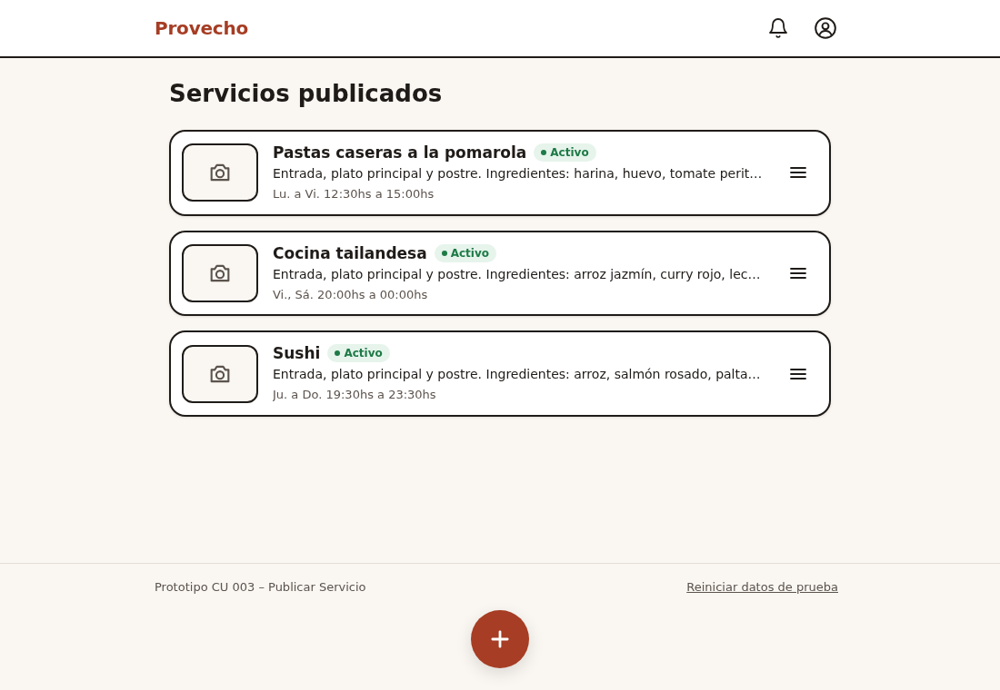
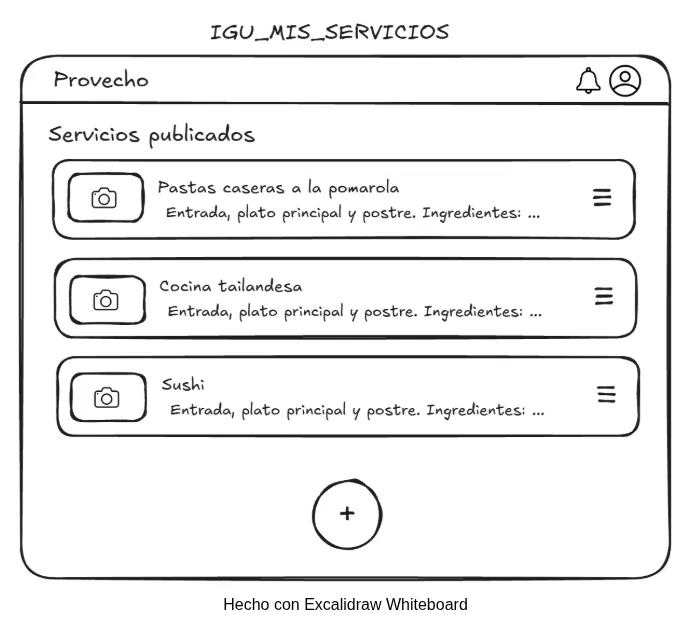
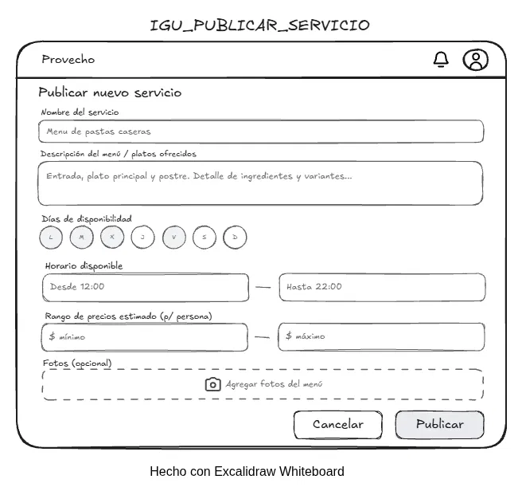
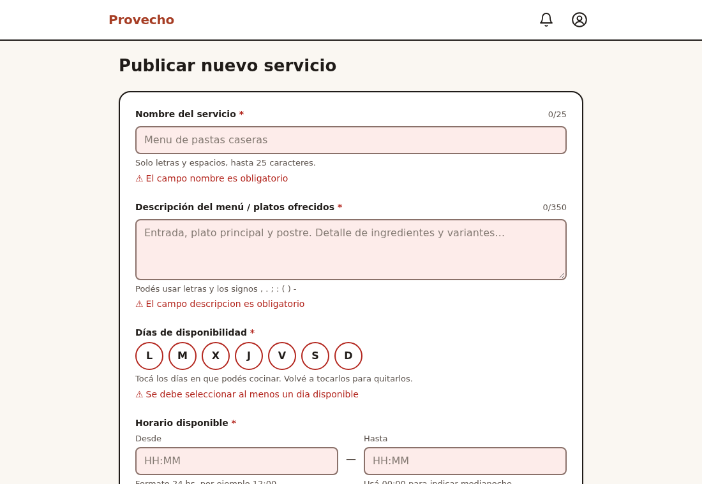
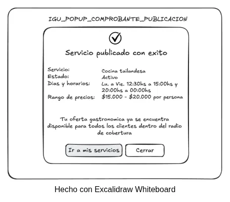
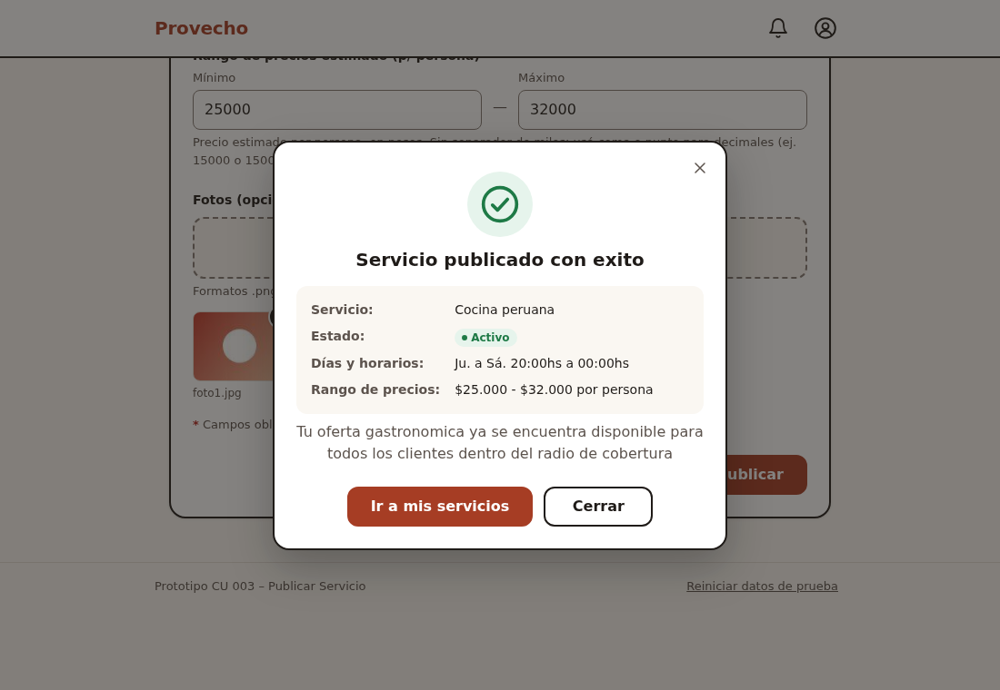
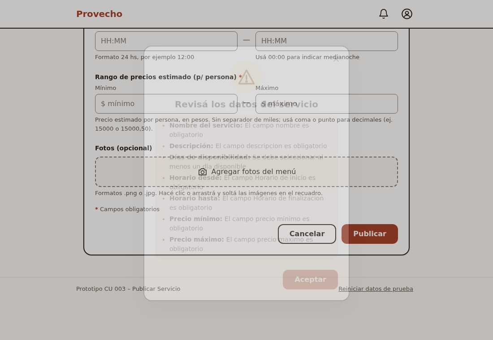
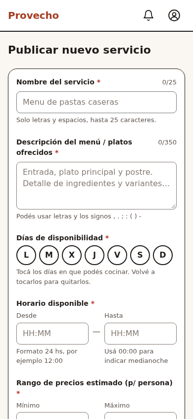

# Provecho · CU 003 – Publicar Servicio

Prototipo funcional y navegable del caso de uso **CU 003 – Publicar Servicio** de **Provecho**, una plataforma que conecta **Cocineros** a domicilio con **Clientes**.

El objetivo del prototipo es **validar el flujo con usuarios y docentes**: se puede recorrer el flujo normal y todos los flujos alternativos tal como están especificados, sin backend (la persistencia se simula en el navegador).

> Trabajo práctico de **Ingeniería de Software** · Desarrollado con *Spec-Driven Development*: la especificación del caso de uso es la fuente de verdad y todo lo que no estaba especificado quedó documentado como `// SUPUESTO:` en el código.



🎬 **Video demo (1 min):** [`demo/demo-cu003-publicar-servicio.mp4`](demo/demo-cu003-publicar-servicio.mp4)

---

## Índice

- [Cómo levantarlo](#cómo-levantarlo)
- [El caso de uso](#el-caso-de-uso)
- [Pantallas](#pantallas)
- [Reglas de validación](#reglas-de-validación)
- [Diseño del código](#diseño-del-código)
- [Usabilidad: Shneiderman y Nielsen](#usabilidad-shneiderman-y-nielsen)
- [Tests E2E con Cypress](#tests-e2e-con-cypress)
- [Supuestos](#supuestos)
- [Estructura del repositorio](#estructura-del-repositorio)

---

## Cómo levantarlo

El prototipo es **HTML, CSS y JavaScript puro** (sin frameworks, sin librerías, sin build).

### Opción 1 – Abrir el archivo

Abrí `index.html` con doble clic o arrastralo al navegador. Listo.

### Opción 2 – Servidor estático (opcional)

```bash
npx serve .
# o
python3 -m http.server 8080
```

y entrá a `http://localhost:8080`. Se puede publicar tal cual en GitHub Pages, Netlify, etc.

### Datos de prueba

- Arranca con 3 servicios de ejemplo: *Pastas caseras a la pomarola*, *Cocina tailandesa* y *Sushi*.
- Lo que publiques queda guardado en el `localStorage` del navegador.
- El botón **"Reiniciar datos de prueba"** (abajo, en el pie) vuelve a los 3 servicios iniciales.

---

## El caso de uso

**CU 003 – Publicar Servicio** (trazo fino, v2)

| | |
|---|---|
| **Actor** | Cocinero |
| **Objetivo** | Exponer su oferta gastronómica (platos, días y horarios, rango de precios) a los Clientes de su zona de cobertura. |
| **Precondiciones** | El Cocinero está autenticado, tiene la documentación validada y vigente y un radio de cobertura configurado (5 km). Se simulan con datos mock: el Cocinero es *Ramiro Staropoli*. |
| **Postcondición** | El servicio queda registrado con estado **"Activo"**, asociado al Cocinero y visible para los Clientes dentro de su radio. |

### Flujo normal

1. El Cocinero ingresa a **Mis servicios**.
2. El sistema lista sus servicios publicados y la opción **"Publicar nuevo servicio"** (botón "+").
3. El Cocinero selecciona "Publicar nuevo servicio".
4. El sistema muestra el formulario.
5. El Cocinero completa los datos y presiona **"Publicar"**. → *FA 5*
6. El sistema verifica disponibilidad (`<<include>>`, simulado), valida los datos, registra el servicio como **Activo** y muestra el **comprobante**. → *FA 6*

### Flujos alternativos

- **FA 5 – Cancelar:** pide confirmación (*"¿Está seguro que desea cancelar?"*). "Sí, cancelar" descarta todo y vuelve a Mis servicios; "No, volver" conserva los datos. Si el formulario está vacío vuelve directamente.
- **FA 6 – Datos incompletos o inválidos:** muestra un popup con **todos** los errores juntos; al presionar "Aceptar" resalta en rojo los campos erróneos, conserva los datos y pone el foco en el primer error.

---

## Pantallas

Se respetó la disposición de las IGU de baja fidelidad y se pasaron a alta fidelidad.

| Baja fidelidad | Prototipo |
|---|---|
|  |  |
|  |  |
|  |  |

| Pantalla / popup | Qué muestra |
|---|---|
| **IGU_MIS_SERVICIOS** | Tarjetas con miniatura, nombre, descripción truncada, chip **Activo**, días y horario y menú ☰ (fuera de alcance). Botón flotante "+". Estado vacío si no hay servicios. |
| **IGU_PUBLICAR_SERVICIO** | Nombre, descripción (contador x/350), días **L M X J V S D** como toggles, horario desde/hasta, rango de precios por persona y fotos opcionales (clic o arrastrar y soltar). |
| **IGU_ERROR_DATOS** | Lista de todos los errores con el campo al que corresponden. |
| **IGU_POPUP_CANCELACION** | Confirmación de cancelación. |
| **IGU_POPUP_COMPROBANTE_PUBLICACION** | Resumen: servicio, estado, días y horarios (*"Lu. a Vi. 12:30hs a 15:00hs"*), rango de precios (*"$15.000 - $20.000 por persona"*). |

<p align="center">
  
  
</p>

---

## Reglas de validación

La validación se ejecuta **solo al presionar "Publicar"** (como indica el FA 6) y **acumula todos los errores**.

| Campo | Regla | Errores posibles |
|---|---|---|
| **Nombre** | Obligatorio, 1 a 25 caracteres, solo letras (con acentos y ñ) y espacios | vacío · más de 25 · caracteres que no son letras |
| **Descripción** | Obligatoria, 1 a 350 caracteres; letras, espacios y `, . ; : ( ) -` | vacía · más de 350 · números u otros símbolos |
| **Días** | Al menos uno | ningún día seleccionado |
| **Horario desde / hasta** | Obligatorios, `HH:MM`, hora 00–23, minutos 00–59, **hasta > desde** | vacío · formato · hora inválida · minutos inválidos · hasta ≤ desde |
| **Precio mínimo / máximo** | Obligatorios, decimal ≥ 0 (punto o coma), hasta 20 caracteres, **mínimo ≤ máximo** | vacío · no numérico · más de 20 · negativo · mínimo > máximo |
| **Fotos** | Opcionales; cada archivo `.png` o `.jpg`/`.jpeg` | formato inválido |

**Excepción de medianoche:** `00:00` en *Hasta* significa fin del día, así que `20:00 a 00:00` es válido. `00:00 a 00:00` no, y tampoco se permiten rangos que crucen la medianoche (`22:00 a 02:00`).

Los horarios y precios son **inputs de texto** (no `type="time"` / `type="number"`) y no tienen `maxlength`, a propósito: así se pueden probar los casos inválidos de la caja negra (`24:30`, `0823`, `A`, etc.).

---

## Diseño del código

Las validaciones usan el patrón **Chain of Responsibility**, alineado con el diagrama de clases:

```
ControladorPublicarServicio
 ├─ construirCadenaValidacion()
 │    ValidadorNombre → ValidadorDescripcion → ValidadorDias
 │    → ValidadorHorarios → ValidadorPrecios → ValidadorFoto
 ├─ verificarDisponibilidad()   (<<include>> simulado, ~800 ms)
 └─ registrarServicio()         → Servicio { estado: "Activo", cocinero, ... }
```

- `ValidadorBase` define `setSiguiente(validador)` y `validar(datos, errores)`: cada eslabón hace su chequeo y **siempre** delega al siguiente, así se juntan todos los errores.
- Cada error es `{ campo, mensaje }`, lo que permite resaltar el campo exacto.
- La UI es una SPA: muestra y oculta secciones sin recargar la página.

| Archivo | Responsabilidad |
|---|---|
| `js/validadores.js` | `ValidadorBase` y los 6 validadores concretos |
| `js/controlador.js` | `ControladorPublicarServicio`, `Servicio`, `RepositorioServicios` (localStorage) y formato de días/precios |
| `js/ui.js` | Navegación, modales (foco atrapado, Esc), formulario, fotos y resaltado de errores |

El código está comentado indicando el paso del CU (`// CU003 - Paso 6`, `// FA 6.3`) y la regla de usabilidad aplicada (`// Nielsen #5`).

---

## Usabilidad: Shneiderman y Nielsen

<details>
<summary><b>Las 8 reglas de oro de Shneiderman</b></summary>

1. **Consistencia:** mismos estilos de botones primario/secundario y mismos modales en todo el flujo.
2. **Atajos:** Enter publica, Esc cierra los popups, todo se navega con Tab.
3. **Retroalimentación:** hover/focus en todo, toggles visibles, spinner "Publicando…", contadores de caracteres.
4. **Diálogos de cierre:** el comprobante deja claro que terminó y cuál es el siguiente paso.
5. **Manejo de errores:** formato esperado visible, mensaje debajo de cada campo, datos conservados, el resaltado se quita al corregir.
6. **Reversión:** cancelar con confirmación, quitar fotos, deseleccionar días.
7. **Control del usuario:** nada se publica sin "Publicar" y nada se descarta sin confirmar.
8. **Carga de memoria:** etiquetas siempre visibles, placeholders con ejemplos, resumen completo en el comprobante.

</details>

<details>
<summary><b>Las 10 heurísticas de Nielsen</b></summary>

1. **Visibilidad del estado:** spinner al publicar, chip "Activo", servicio nuevo resaltado.
2. **Mundo real:** lenguaje gastronómico, pesos con separador de miles, días como en un calendario.
3. **Control y libertad:** salir del formulario en cualquier momento, cerrar modales con X o Esc.
4. **Consistencia y estándares:** primario a la derecha, `*` para obligatorios.
5. **Prevención de errores:** botón deshabilitado mientras procesa (sin doble envío), selector que acepta solo imágenes.
6. **Reconocer antes que recordar:** días como botones, datos visibles en el comprobante.
7. **Flexibilidad:** atajos de teclado, arrastrar y soltar fotos.
8. **Minimalismo:** solo lo necesario en cada pantalla.
9. **Recuperarse de errores:** mensajes claros, foco en el primer error.
10. **Ayuda:** textos breves bajo los campos (*"Usá 00:00 para indicar medianoche"*).

</details>

**Accesibilidad:** `<label>` en cada campo, `aria-invalid` y `aria-describedby` en los errores, popups con `role="dialog"` y `aria-modal`, foco atrapado y devuelto al elemento que abrió el popup, contraste AA, foco visible y diseño responsive.

---

## Tests E2E con Cypress

**113 tests** que verifican toda la UI y los criterios de aceptación de la especificación.

### Requisitos

- Node.js 18 o superior
- Para los tests de teclado se necesita Electron (incluido en Cypress) o Chrome.

### Instalación y ejecución

```bash
npm install

npm test              # corre todo en modo headless (Electron)
npm run test:chrome   # corre todo en Chrome
npm run cy:open       # abre la interfaz de Cypress para verlos paso a paso
```

No hace falta levantar un servidor: Cypress sirve `index.html` directamente.

### Qué cubre cada spec

| Spec | Tests | Cubre |
|---|---|---|
| `01_mis_servicios` | 9 | Header, listado, tarjetas, botón "+", menú ☰, estado vacío, reiniciar datos |
| `02_formulario` | 15 | Orden de campos, etiquetas, placeholders, contadores, toggles de días, fotos (selector, arrastrar y soltar, quitar) |
| `03_validaciones` | 41 | Cada regla de la tabla con su mensaje exacto, errores múltiples, resaltado, foco en el primer error, corrección |
| `04_publicacion_exitosa` | 19 | Publicación con y sin foto, valores límite, medianoche, comprobante, spinner, doble envío, persistencia, postcondición |
| `05_cancelar` | 11 | FA 5 completo: sin datos, "Sí, cancelar", "No, volver", X y Esc |
| `06_teclado_accesibilidad` | 18 | Flujo completo solo con teclado, foco atrapado, menú con flechas, tooltip, ARIA, responsive |

Los comandos reutilizables (`completarValido`, `debeMostrarErrores`, `campoDebeTenerError`, etc.) están en `cypress/support/commands.js`, y los datos de prueba en `cypress/fixtures/`.

---

## Supuestos

Lo que la especificación no definía se resolvió con la opción más simple y quedó marcado con `// SUPUESTO:` en el código:

1. El prototipo arranca directamente en **Mis servicios**; la campana y el perfil son decorativos.
2. Los horarios usan placeholder `HH:MM`, con las etiquetas "Desde" y "Hasta" siempre visibles.
3. La hora requiere 2 dígitos (`9:30` es inválido, se escribe `09:30`).
4. Se ignoran los espacios al inicio y al final de cada campo.
5. Un precio decimal es `123`, `123,45` o `123.45`. No se usa separador de miles (`15.000` se leería como 15).
6. Los errores "mínimo > máximo" y "hasta ≤ desde" se marcan en el campo **máximo** y en el campo **hasta**.
7. El formato de la foto se determina por la extensión del archivo.
8. Primero se valida (instantáneo) y solo con datos correctos se simula *Verificar disponibilidad* (~800 ms).
9. Días abreviados con 2 letras (`Lu.`, `Vi.`, `Sá.`); 3 o más días seguidos se muestran como rango (`Lu. a Vi.`).
10. Si se llena el `localStorage`, se guarda solo la primera foto (o ninguna).

---

## Estructura del repositorio

```
.
├── index.html                  Pantallas y popups
├── css/styles.css              Estilos (variables CSS, responsive)
├── js/
│   ├── validadores.js          Chain of Responsibility
│   ├── controlador.js          Controlador, Servicio, persistencia
│   └── ui.js                   Navegación, modales, formulario
├── cypress/
│   ├── e2e/                    6 specs (113 tests)
│   ├── fixtures/               Imágenes, PDF y servicio válido de prueba
│   └── support/                Comandos reutilizables
├── cypress.config.js
├── package.json
├── docs/
│   ├── igu/                    IGU de baja fidelidad
│   └── capturas/               Capturas del prototipo
└── demo/                       Video demo
```
